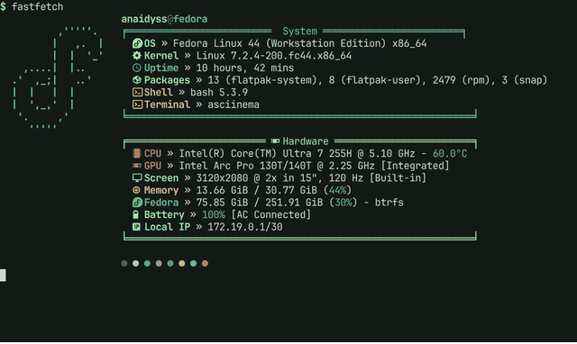
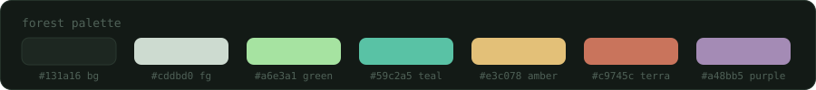

# dotfiles

fedora 44 + niri. every app themed to one palette, two themes: **forest** (green)
and **graphite** (veil style: warm charcoal, clay + amber accents, square corners).
switch with `theme toggle`.




## what's inside

- **wm**: niri (config.kdl, lock and vpn status scripts)
- **bar**: waybar + swayosd, custom lid/pm toggle modules
- **terminal**: kitty + fish + starship (two-line prompt: pills in forest,
  box-drawing frame in graphite)
- **launcher**: fuzzel
- **lock**: hyprlock as fallback, the real one is
  [veil](https://github.com/anaidyss/veil) (python + ext-session-lock-v1,
  separate repo)
- **editor**: nvim, lazy.nvim + gruvbox overridden to forest colors — full IDE:
  treesitter, LSP (mason + jdtls for Java), nvim-cmp, telescope, neo-tree,
  lualine + bufferline, gitsigns, conform, noice/notify, alpha dashboard,
  lazygit + diffview, flash/surround, trouble, todo-comments, spectre,
  persistence + undotree, toggleterm, ufo folding, markdown preview,
  statuscol gutter + barbecue winbar, mini.animate/indentscope/cursorword
- **vscodium**: installed without root by `install-codium.sh` (official tarball, sha256
  checked); the "Veil" color themes (graphite + forest) are generated from the
  palette and follow `theme toggle`
- **themes**: `theme` switcher + `palette.toml` (every color is a role with a
  forest and a graphite value), see below
- **menus**: veil-power / veil-sys / veil-wifi / veil-bt / veil-audio — gtk4 popups
  on gtk4-layer-shell built from one shared kit (`veilkit`), no external
  processes where a d-bus/sysfs/libnm api exists. fade + slide in/out, lists
  update in place (no flicker, hover survives), ~0.3 s from click to window
  (no `application_id` / d-bus registration, cairo renderer; a second launch
  closes the open menu via pid file + SIGUSR1). veil-audio has a left / right /
  both headphone test (keys l / r / b)
- **speaker guard**: waybar button that hard-mutes the laptop speakers (alsa
  `Speaker` + `Bass Speaker`) and leaves headphones alone; a small user service
  re-mutes them if wireplumber unmutes (`speaker_guard.sh`, `speaker-guard.service`)
- **fastfetch**: framed blocks closed on all sides by `ff-box`, fedora logo
  drawn in block characters (graphite)
- **the rest**: btop, yazi, bat, eza, zoxide, mako, peaclock, pipes, gtk3/gtk4
  layer (nautilus), kde color scheme

## install

    ./install.sh

just copies files into ~, no symlinks, keeping it simple. secrets, vpn and
browser configs are not included (secrets live in ~/.config/secrets/env,
gitignored).

then pick a theme: `theme graphite` (shipped state) or `theme forest`.

font everywhere: JetBrainsMono Nerd Font, lives in ~/.local/share/fonts.

## themes

    theme toggle | forest | graphite | status | audit | wallpaper <file>

- `~/.config/theme/palette.toml`: roles -> `[forest, graphite]` values. switching
  replaces colors in place in the configs (one pass, idempotent, reversible),
  then reloads waybar, mako, kitty, swayosd, swaybg.
- small per-theme overrides (shape: radii, borders, gaps, prompts) are regex
  `settings` in the same file; per-file color tweaks are `filemaps`.
- files that differ structurally (waybar css, starship, fastfetch, greeting,
  gtk layer, peaclock, kdeglobals) live as full per-theme files in
  `~/.config/theme/slots/`; edits to the live file are saved back to the slot on
  the next switch.
- `theme audit` lists colors in the target files that the palette doesn't know.
- the wallpaper follows the theme: graphite uses a tinted copy (cached).
- telegram theme: `.config/theme/telegram/veil-graphite.tdesktop-theme`,
  send it to saved messages and press apply.

## structure

```text
.config/
  niri/       wayland wm: config.kdl + lock.sh, vpn_status.sh
  waybar/     bar: config, style, lid/pm/speaker-guard modules
  kitty/      terminal + forest theme
  fish/       shell config, starship.toml next to it
  nvim/       init.lua + lua/core + lua/plugins (full IDE, forest theme)
  fuzzel/     launcher
  hypr/       hyprlock fallback
  fastfetch/  system info (+ fedora logo tile)
  theme/      palette.toml, slots/ (per-theme files), tools/ (logo + vscode theme generators), telegram theme
  VSCodium/   user settings (font, shape, default theme)
  gtk-3.0/ gtk-4.0/   titlebar css + shared veil layer
  btop/ bat/ yazi/ mako/ swayosd/   the rest, both themes
.local/bin/   theme, ff-box, veil-power/sys/wifi/bt/audio, wallpaper,
              screenshot-area, lock-music, lock-battery
.local/lib/   veilkit (popup design system)
.local/share/ color-schemes (kde)
.peaclock/    peaclock config
install.sh    copies everything into place
install-codium.sh   optional: vscodium from the official tarball + veil theme
```

## custom bits

- **lid-sleep**: systemd user unit + waybar/lid-watcher.sh, suspends the
  laptop on lid close, toggled by clicking the module in the bar
- **wallpaper**: switcher script with list, numbered picker, next/prev and
  random modes, no deps
- **lock-music / lock-battery**: hyprlock widgets, mpris metadata and
  battery with color depending on the charge
- **screenshot-area**: region screenshot, bound to Print and Mod+Shift+S
- **veilkit**: panels with `[ TITLE ]` cut into the top border, `LABEL: value`
  rows, `[|||||.....]` meters, two-step confirm buttons; colors come from the
  palette, shape from `[tokens.<theme>]`

the demo gif is a real session: assets/demo.sh runs fastfetch, eza and bat
against this repo, assets/record.sh rebuilds the gif (asciinema +
termtosvg + headless chrome + ffmpeg).
